# Branchi — a fast git client for Windows and Linux

**Branchi** is a desktop git client for Windows and Linux with a **Rust** core
and a **Flutter** UI. It covers the everyday work — history, staging,
committing, branches, pull and push — and adds what most git GUIs leave out:
**updating every repository in a folder at once**, **activity reports for a
repository and for each author**, a **built-in terminal**, and full
**Persian/Arabic (RTL) and Jalali calendar** support.

If you are looking for a **git client for Windows**, a lighter
**GitHub client for Windows**, or an alternative to Fork, Sourcetree,
GitHub Desktop, GitKraken or TortoiseGit, give Branchi a try.

<p align="center">
  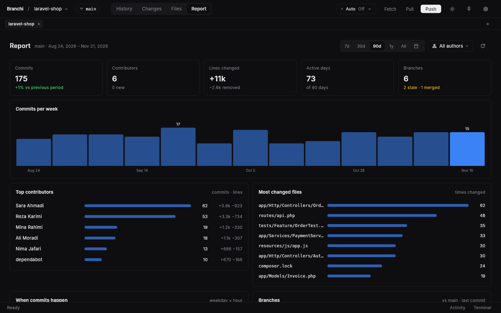
</p>

## Why Branchi

- **Existing git clients fell short.** Many are heavy, slow to start, paid,
  or missing everyday features.
- **Many repositories, one place.** Real work is spread across many repos.
  Branchi opens them side by side in tabs, updates a whole folder of them in
  one click, and reports on each.
- **Fast and native.** A Rust core (libgit2) does the git work; Flutter draws
  the UI, natively on each platform.
- **Persian and RTL first-class.** The whole UI works right-to-left in Persian
  and Arabic, and dates can use the Jalali (Solar Hijri) calendar.

### Built for how software is made now

The whole development process is changing. With AI coding assistants, code
gets written faster, more branches and commits pile up, and one person keeps
more repositories moving at once. A git client has to change with it: it
should keep many repositories up to date without busywork, and show clearly
what changed, where and by whom, so people stay on top of the work.
That is what Branchi is being built for.

## Features at a glance

- History with branches, commit search and file-by-file diffs
- Stage, unstage, revert and commit — or commit and push in one step
- Fetch, pull (fast-forward) and push, plus remote management
- Auto-pull branch watcher that keeps the current branch up to date
- Tabs for several repositories, restored on the next launch
- Update all repositories in a folder at once, safely
- Activity reports for the whole repository and for each author
- Custom date ranges, Gregorian or Jalali calendar
- Built-in file browser and code editor
- Built-in terminal with multiple terminal tabs
- Light and dark themes, accent colors, English, Persian and Arabic
- No separate Git install needed for everyday work — the git engine is built in

## Screenshots

<p>
  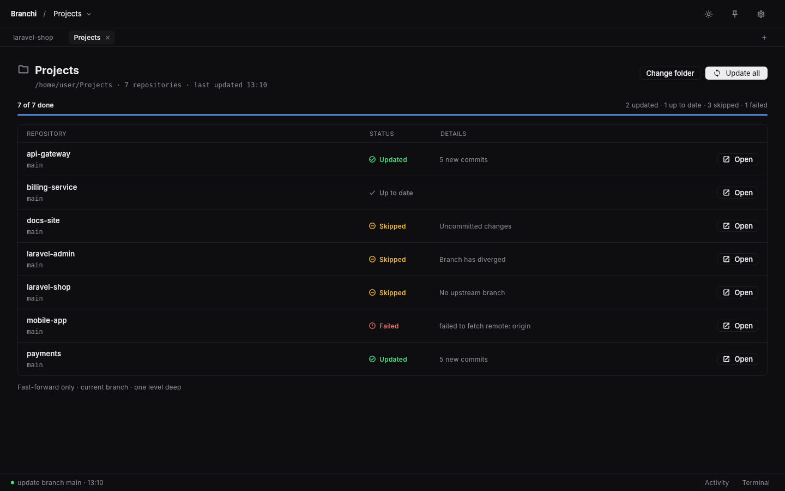
  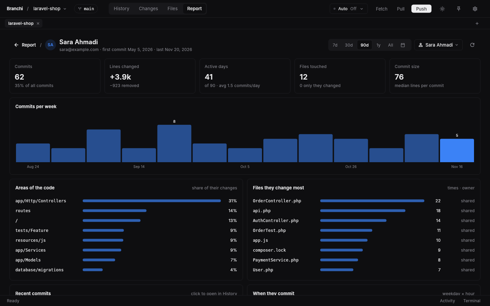
</p>
<p>
  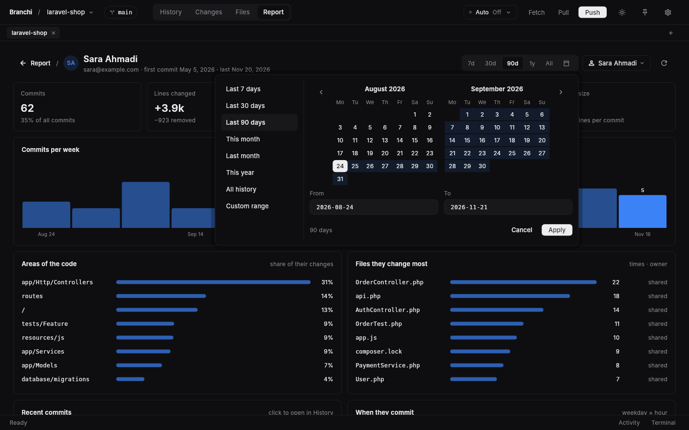
  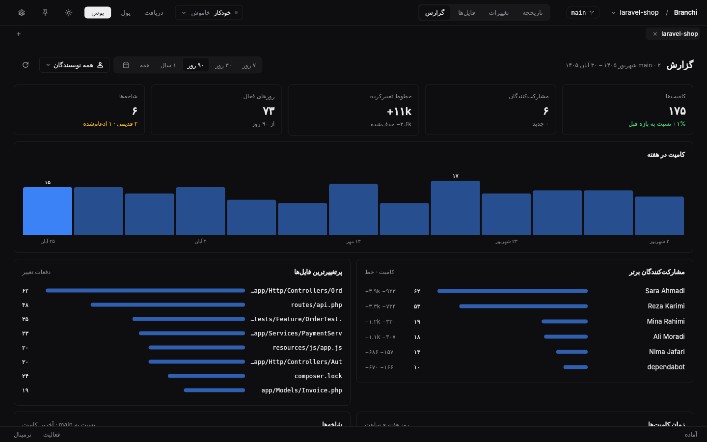
</p>
<p>
  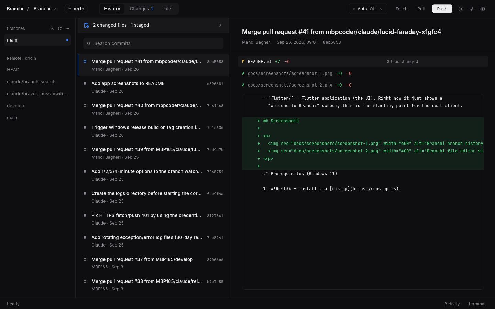
  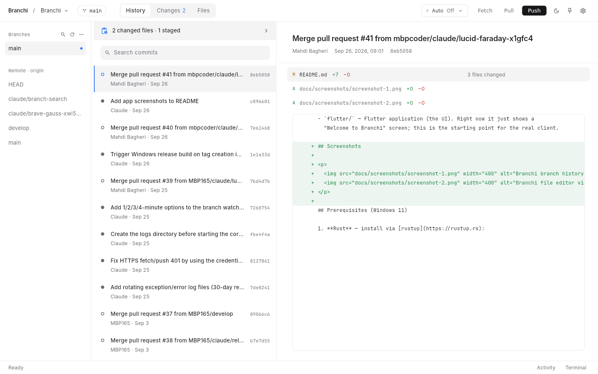
</p>
<p>
  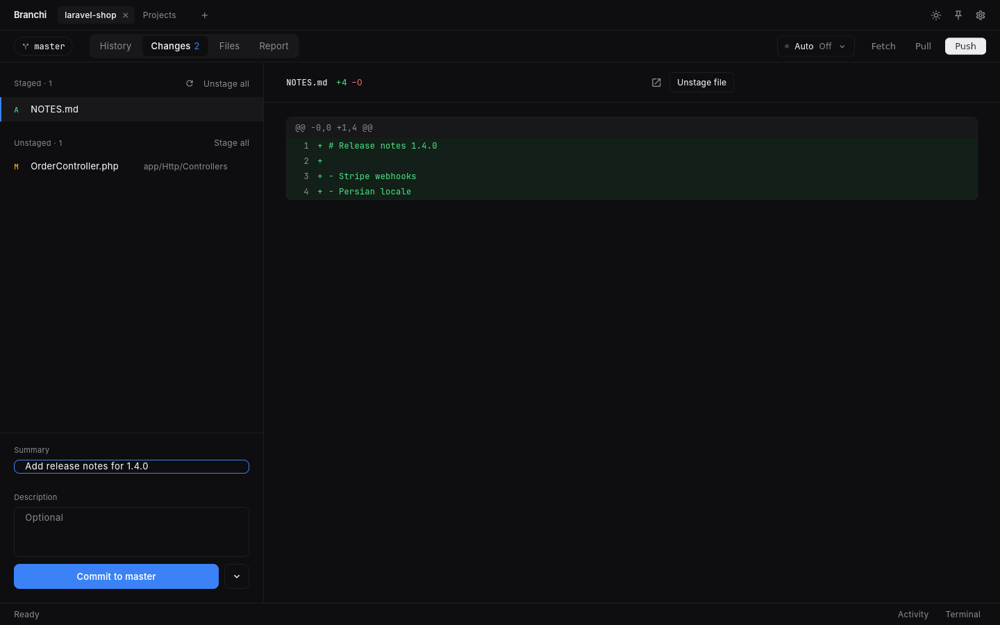
  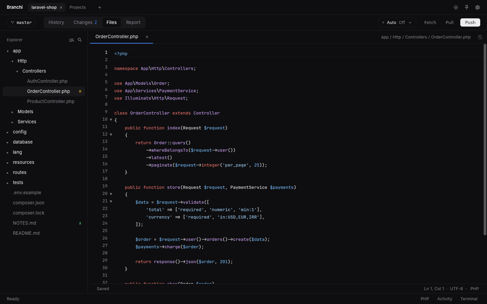
</p>
<p>
  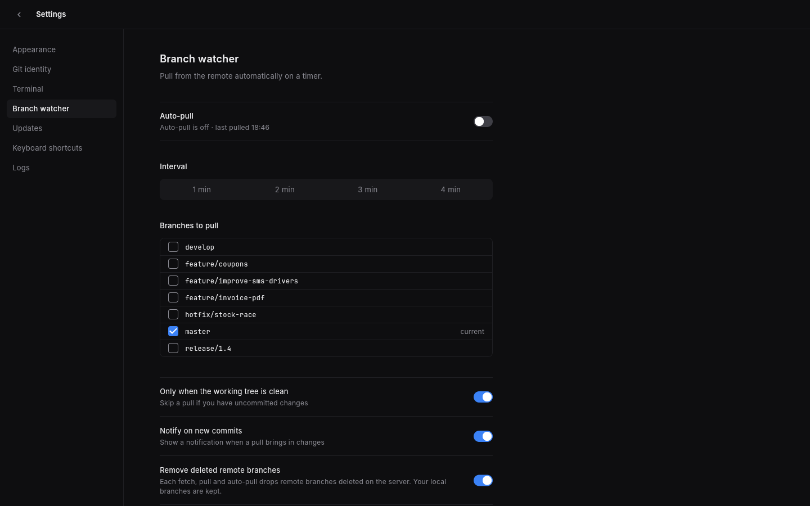
  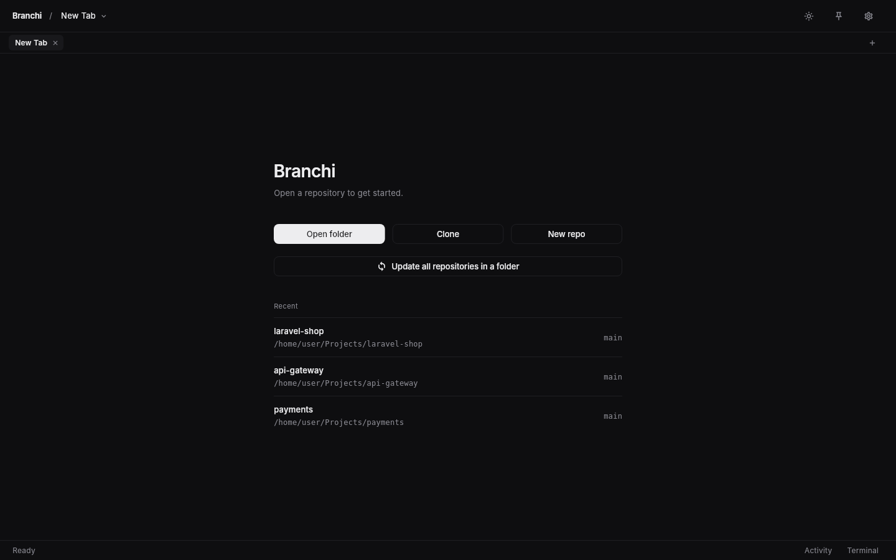
</p>

## Install

**Windows (Scoop):**
```powershell
scoop bucket add branchi https://github.com/mbpcoder/Branchi
scoop install branchi
```

**Windows (installer):** download `branchi-setup.exe` from the
[latest release](https://github.com/mbpcoder/Branchi/releases/latest).

**Linux (Snap):**
```bash
sudo snap install branchi --classic
```

To build it yourself, see [Building from source](#building-from-source).

## Features

### History, changes and files
Browse the commit history next to your local and remote branches, search
commits, and open any commit to see its diff file by file. The **Changes**
view stages, unstages and reverts files and commits, or commits and pushes
in one step. The **Files** view is a file tree with a built-in code editor.

### Pull, push and auto-pull
Fetch, pull and push from the top bar. Pulls are fast-forward only, so your
branch is never rewritten behind your back. The **branch watcher** can pull
the current branch on a schedule, only when the working tree is clean, and
notify you when new commits arrive.

### Tabs for many repositories
Open each repository in its own tab. Tabs, and their terminals, come back
the next time you start Branchi. Middle-click a tab to close it.

### Update all repositories in a folder
Pick a folder and Branchi opens it as a tab listing every git repository
inside it. **Update all** fast-forwards each repository's current branch, a
few at a time. Repositories with uncommitted changes, a diverged branch, no
upstream or a detached HEAD are skipped and never touched, and each row says
why. Click **Open** to jump into any of them.

### Reports
The **Report** section shows a repository's activity for any period: commits
compared with the previous period, contributors, lines changed, active days,
commits per day/week/month, top contributors, most changed files, a
weekday × hour heatmap, and branches compared with `main` (ahead/behind,
merged, stale). Click a contributor to see their own report: share of
commits, files only they changed, typical commit size, the areas of the code
they work in, recent commits, when they commit and their branches. Pick a
preset (7 days, 30 days, 90 days, a year, all history) or any custom date
range. Anyone with access to the repository can see its reports.

### Built-in terminal
Each repository tab has its own terminal panel with multiple terminal tabs,
opened in the repository folder. Choose which shell to use in Settings.

### Languages, RTL and calendars
English, Persian and Arabic, with a full right-to-left layout. Dates follow
the **Calendar** setting: automatic (Jalali for Persian), Gregorian or Jalali.

## Branchi and other git clients

Branchi is a desktop git GUI like Fork, Sourcetree, GitHub Desktop,
GitKraken and TortoiseGit. What it focuses on:

- **Many repositories:** update a whole folder of repos in one click.
- **Insight:** built-in activity reports per repository and per author.
- **Built-in git engine:** everyday git work runs through libgit2 inside the
  app, without shelling out to a `git` command.
- **RTL and Jalali:** made to work well in Persian and Arabic.
- **Any git host:** works with GitHub, GitLab, Bitbucket, Gitea or your own
  server — it's plain git.

## Building from source

Branchi is built the same way as [RustDesk](https://github.com/rustdesk/rustdesk):
a Rust core with a Flutter UI on top.

- `core/` — Rust library (`branchi-core`) with the git logic.
- `flutter/` — Flutter application (the UI).

### Prerequisites (Windows 11)

1. **Rust** — install via [rustup](https://rustup.rs):
   ```powershell
   winget install Rustlang.Rustup
   ```
2. **Flutter SDK** — install via [flutter.dev](https://docs.flutter.dev/get-started/install/windows)
   or with [Scoop](https://scoop.sh):
   ```powershell
   scoop bucket add extras
   scoop install flutter
   ```
   (There is no official `Flutter.Flutter` winget package — Scoop's `extras`
   bucket is the simplest package-manager route on Windows.)

   Then verify your setup:
   ```powershell
   flutter doctor
   ```
   Make sure the **Windows desktop** toolchain requirements are satisfied
   (Visual Studio 2022 with the "Desktop development with C++" workload).
3. Enable Windows desktop support for Flutter (only needed once):
   ```powershell
   flutter config --enable-windows-desktop
   ```

### First-time setup

The `flutter/` folder contains the Dart source (`pubspec.yaml`, `lib/main.dart`)
but not the generated native platform folders (they aren't checked into the
repo). Generate them once with:

```powershell
cd flutter
flutter create --platforms=windows .
```

This will add a `windows/` folder (and others if you ask for them) without
touching the existing `lib/main.dart`.

Then generate the Windows app icon from `assets/icon/branchi_logo.png`:

```powershell
flutter pub get
flutter pub run flutter_launcher_icons
```

This writes `windows/runner/resources/app_icon.ico` and updates
`windows/runner/Runner.rc` to use it.

### Running the app

```powershell
cd flutter
flutter pub get
flutter run -d windows
```

This opens the Branchi window on the start page.

### Running the built app (after `flutter build`)

`flutter run` compiles and launches the app in one step. To instead build a
release binary and run it separately:

```powershell
cd flutter
flutter build windows
```

The compiled executable is placed at:

```
flutter\build\windows\x64\runner\Release\branchi.exe
```

Launch it directly, e.g.:

```powershell
.\build\windows\x64\runner\Release\branchi.exe
```

or double-click it in File Explorer. The `Release` folder also contains the
`.dll` files the app needs, so keep `branchi.exe` in that folder (or copy the
whole folder) rather than moving the `.exe` alone.

### Building the Rust core

The Rust core builds independently of the UI:

```powershell
cargo build
```

Run its tests with:

```powershell
cargo test
```

### Local database

Branchi stores its local state (known repos, app settings) in **SQLite**,
accessed through [`sqlx`](https://github.com/launchbadge/sqlx) — the same
combination RustDesk's server uses for its own persistence. This keeps the
door open to later pointing at Postgres/MySQL for a hosted/sync scenario,
since `sqlx` supports all three with the same query API.

- `core/src/db.rs` — the `Database` type (connect, migrate, CRUD for repos
  and settings).
- `core/migrations/` — SQL migration files, run automatically on connect
  via `sqlx::migrate!`.

No `DATABASE_URL` or `sqlx-cli` setup is required to build: the code uses
runtime `sqlx::query(...)` calls rather than the compile-time-checked
`sqlx::query!` macro, so `cargo build`/`cargo test` work offline.

### Project layout

```
branchi/
├── Cargo.toml          # Rust workspace
├── core/                # Rust core library (branchi-core)
│   ├── migrations/      # sqlx SQL migrations
│   └── src/
│       ├── git.rs       # git operations (libgit2 via git2)
│       ├── ffi.rs       # C ABI the Flutter app calls through dart:ffi
│       └── db.rs        # SQLite storage layer (sqlx)
└── flutter/             # Flutter UI application
    ├── pubspec.yaml
    └── lib/             # screens, report, terminal, settings, …
```
